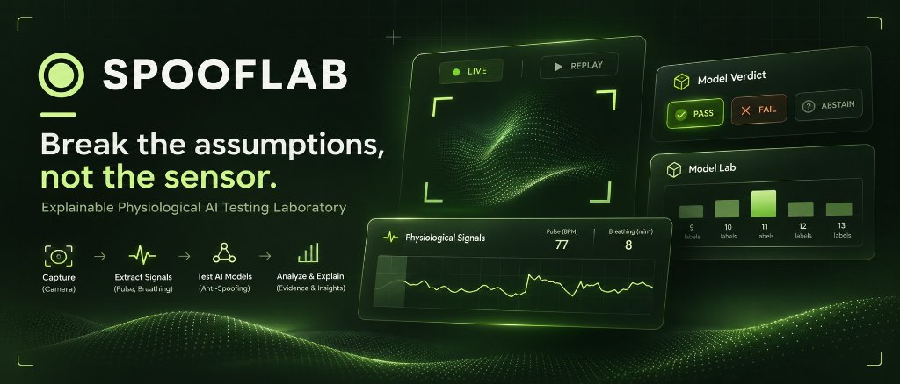

<p align="center">
  
</p>

# SpoofLab

> **Break the assumptions, not the sensor.**  
> Explainable Physiological AI & Presence Policy Testing Laboratory built with Presage SmartSpectra SDK.

A Windows desktop laboratory for testing camera-derived physiology under live, photograph, screen-replay and injected-replay conditions. SmartSpectra supports recordings: pulse output from a recording is expected behavior, not an SDK vulnerability. SpoofLab is not a liveness verifier, authentication product or deepfake detector.

---

## Demonstration Video

Watch the complete 3-minute walkthrough on YouTube: [https://youtu.be/n5iniN8SBrc](https://youtu.be/n5iniN8SBrc)

---

## Run Locally

### Prerequisites & Setup
Use Windows x64, Node.js (24 recommended), a supported webcam (delivered $\ge 25\text{ FPS}$), and a Presage API key with cardio access. Facial metrics are needed for blink challenges.

```powershell
npm ci
npm start
```

Save your key as `PRESAGE_API_KEY=your_presage_key` in the project-root `.env`, or enter it directly into the desktop password field. Browser preview never receives it. Do not commit or display the key.

Report-only preview: `npm run preview`, then open http://127.0.0.1:4173. Preview allows local imports with no SDK capture or invented readings.

---

## App Workflow & Workspaces

- **01 Capture Laboratory:** Confirm processing consent, select the actual camera and run the six-second FPS diagnostic. Trials record optical pulse and breathing alongside real-time frame validation and delivered frame rate. A randomized blink challenge tests freshness.
- **02 Trust Boundaries:** Inspect physiological signal availability separately from the application decision. Three distinct architectural lanes (Measurement $\rightarrow$ Policy $\rightarrow$ Verdict) ensure raw telemetry is never confused with an authentication outcome.
- **03 Policy Arena:** Evaluate three frozen rules against saved measurements with zero metadata leakage. Trials are scored blindly with their declared condition hidden; clicking **Reveal** flips the decision card to expose whether the operator presented a live face or a replay.
- **04 Evidence Report:** Review all 33 retained attempts, completed vs. early ending durations, inconclusive outcomes, and frozen-policy scoreboards with trial-level Wilson confidence intervals.
- **05 Model Lab:** Train on consented saved trials, inspect the 50-run shuffled-label control, predictions and feature contributions. Strict leave-one-group-out evaluation checks independent evidence across groups.
- **06 Export:** Save JSON archives to reopen observations, CSV tables for spreadsheet analysis, or standalone readable HTML reports. Also provides a single-click control to permanently clear local evidence.

See [experiment protocol](docs/EXPERIMENTS.md), [threat model](docs/THREAT_MODEL.md) and [operator steps](docs/NEXT_STEPS.md).

---

## Local ML Setup

```powershell
py -m venv .venv
.\.venv\Scripts\python.exe -m pip install -r ml/requirements.txt
npm run test:ml
```

Desktop training and ML tests run in the local environment; `SPOOFLAB_PYTHON` can specify another interpreter. Model Lab training executes entirely locally on device.

- **Exploratory mode:** Fits logistic regression and optional XGBoost to consented trial records. Its headline uses an actual 50-run shuffled-label control, not an unverified accuracy claim on new sessions.
- **Strict grouped evaluation:** Requires four connected groups containing both eligible live and non-live observations. Unsupported strict evaluation returns `insufficient_data`; exploratory fitting remains available. This safeguard was added after reviewing the data, not preregistered as a scientific result.
- **Limits analysis:** Leave-one-group-out (LOOCV) cross-validation evaluates whether physiological features generalize across independent capture contexts without active challenges.

Models are fitted per run; reports retain results and explanations, not a deployed live-camera classifier. See [ML workflow](docs/ML.md) and [limitations](docs/ML_LIMITATIONS.md).

---

## Consent and Data Handling

Consent is required before processing. Dataset consent, recording-source permission and public-use permission are separate. Show only approved footage or aggregates in anything public.

- **Storage and retention:** Desktop measurements, metadata and failures autosave in `data/trials/` and restore at startup until deleted. The application records no video, image or audio stream to disk. Browser-preview reports stay in memory unless exported.
- **Deletion:** **Clear all** deletes the desktop trial store and clears reports in memory. Separately exported reports, numeric diagnostics, analysis artifacts and operator-created recordings remain until deleted separately. Revoking dataset consent excludes future exports; it cannot erase existing copies.
- **Sharing:** No automatic report uploads or cloud training datasets.
- **AI service & LLM interactions:** The SDK documents automatic LLM Insights that can send derived pulse, breathing, and heart-rate variability measurements with session metadata to Presage for forwarding to an external AI service. SpoofLab makes no on-demand Insights requests, and no external AI service or LLM is called during policy scoring. Review physiological exports before sharing.
- **SDK telemetry:** Disabled explicitly in configuration. SDK authentication and runtime network behavior still apply.

Presage states: “Telemetry does not attach raw video/image frames or measured physiological values.” [Official telemetry page](https://smartspectra.presagetech.com/docs/telemetry-and-privacy), read November 15, 2026. This describes telemetry, not all SDK operations. See [PRIVACY.md](docs/PRIVACY.md).

---

## Verification & Testing

```powershell
npm run check
npm test
npm run build
npm run test:ml
npm run test:browser
npm run test:desktop
```

Browser tests use synthetic capture fixtures. Desktop checks open no camera; when local consented evidence exists, they exercise real Python training. Tests do not validate physiological accuracy or establish liveness.

With existing private evidence, generate derived outputs without rewriting original trials:

```powershell
npm run traces
npm run analyze
npm run summarize
npm run post
node scripts/harness.cjs --final --public-root D:\prestige-public
```

---

## Source-Only Release Boundary

Original development history contains private evidence and must not be published. `npm run source:prepare` creates an allowlisted review copy under ignored `artifacts/`, excluding trial data, populated `.env`, recordings and Git history. A separate clean source-only repository is maintained at `D:\prestige-public` and pushed to GitHub. Audit it using `node scripts/g10-public-repo.cjs D:\prestige-public` before release.

Source code is MIT licensed: [LICENSE](LICENSE). This grants no rights to participant data, third-party recordings or the SDK, which retain their own terms.
