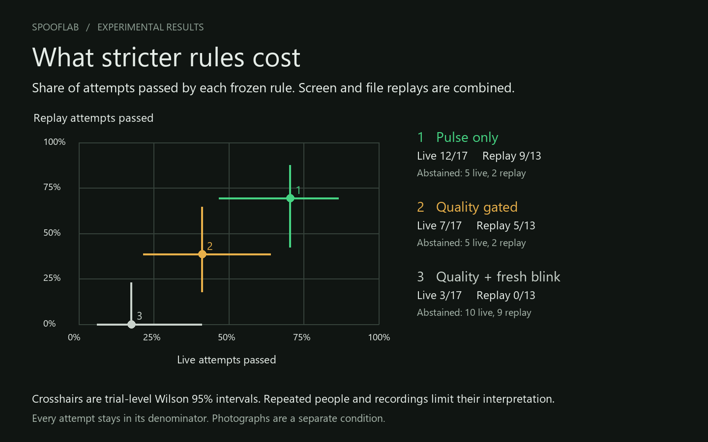

I added a quality check to a rule that counted pulse estimates from a webcam. Screen replays went from **{{summary.research.naive_screen_pass}} passes to {{summary.research.gated_screen_pass}}** across the same {{summary.by_condition.screen_replay}} attempts. Live passes also fell, from **{{summary.research.naive_live_pass}} to {{summary.research.gated_live_pass}}** across {{summary.by_condition.live}} attempts. Every file replay still passed.

That trade-off is why I built **SpoofLab**. SmartSpectra supports measurements from recordings. The interesting question for an application developer is what happens when a product uses those measurements to decide whether someone is there *now*.

## What I built

SpoofLab is a Windows Electron workbench for inspecting that decision. Capture shows live SmartSpectra pulse and breathing readings, camera frame rate, validation warnings, and an optional randomized blink prompt. After capture, the Policy Arena lets you pick a saved attempt with its input condition hidden. Score it, read the reasons, then reveal whether the operator used a live camera subject, a photograph, a screen replay, or a video file.

Each frozen rule reads the same saved measurements. The first counts pulse estimates after warm-up. The second also checks how often the pulse was stable and how many frames had validation warnings. The third adds an exact-count blink prompt issued during the trial. The decision trace records the thresholds, observations, and missing fields so another developer can inspect why a particular rule passed, failed, or abstained.

## Demo



The horizontal axis shows live passes. The vertical axis combines screen and file replay passes. Each marker represents a different rule applied to the same ledger. The crosshairs give descriptive Wilson intervals. Several attempts share a person or recording, so the intervals cannot establish performance on independent people.

<!-- Before publication: embed the reviewed video showing changing live SDK readings, upload the chart to DEV, and insert the verified public repository link in the setup section. -->

## What the evidence showed

The ledger contains **{{summary.total_trials}} attempts**. Of those, **{{summary.completed}}** completed the prescribed duration. The other **{{summary.incomplete}}** ended early, with recorded stop reasons of {{summary.research.failure_text}}. All attempts remain in the table. Read each cell as **pass / fail / abstain**. An abstention means the rule lacked enough evidence to decide.

{{summary.research.frozen_policy_table}}

The file column matters. A quality check cut screen-replay passes to {{summary.research.gated_screen_pass}}, yet it passed **all {{summary.by_condition.injected_replay}}** file replays. Pooling the two kinds of replay would hide that difference. These runs establish what happened on this setup. They cannot tell us which property of the display or capture path caused it.

### Did the blink prompt work?

On live trials, **{{summary.research.live_challenge_hits}} of {{summary.research.live_challenge_usable}} usable completed challenges** matched the requested count. Another {{summary.research.live_challenge_inconclusive}} blink-enabled live attempts had no usable completed challenge. The full pulse-plus-blink rule passed **{{summary.research.blink_live_pass}} of {{summary.by_condition.live}}** live attempts because it also required adequate pulse and frame-quality evidence.

The full rule passed zero replays in this collection. Look at the abstentions before interpreting that result: **{{summary.research.blink_screen_abstain}} of {{summary.by_condition.screen_replay}}** screen replays and **all {{summary.by_condition.injected_replay}} file replays** went unscored. A developer who counts those as successful rejections would give the rule credit for decisions it never made.

## What the model added

Model Lab used **{{summary.research.exploratory_trials}} eligible trials** from {{summary.research.ml_consented}} records with separate dataset consent and grouping metadata. When entire connected groups were held out, logistic regression produced a pooled AUC of **{{summary.research.limits_pooled_auc}}**. Only {{summary.research.mixed_groups}} of {{summary.research.total_groups}} groups contained both live and non-live trials. With that little independent evidence, the study cannot establish how well the model would rank new people or sessions.

The training control helps explain why I kept ML secondary: **{{summary.research.shuffled_matches}} of {{summary.research.shuffled_runs}}** fits on shuffled labels matched or exceeded the real-label training fit. XGBoost returned the same score for every training record. Neither result gives me a reason to replace the inspectable rules with a model.

## Code and setup

On Windows x64, install Node.js and obtain a Presage API key with cardio access. Blink challenges also require facial metrics. From the repository root, run:

```powershell
npm ci
npm start
```

Enter the key in the app, review consent, select a camera, and run the frame-rate check before starting a trial. To reproduce the report with your own ledger, set up the local Python environment described in the README, run `npm run summarize`, then `npm run post`. The shared aggregate contains no participant-level traces.

## Consent and Data Handling

The operator confirms processing consent before capture. Using someone else's photograph or recording requires their permission. Including measurements in Model Lab requires a separate opt-in, and showing identifiable footage publicly requires permission for that use.

SpoofLab records no video, images, or audio. The desktop app saves trial measurements and metadata in `data/trials/` until the operator selects **Clear all**. Exported reports, camera diagnostics, and analysis files must be deleted separately. Model Lab trains locally.

SpoofLab sets `enableTelemetry: false`. Presage describes its telemetry boundary this way: “Telemetry does not attach raw video/image frames or measured physiological values.” SDK authentication and other runtime network activity still apply. [Presage telemetry documentation](https://smartspectra.presagetech.com/docs/telemetry-and-privacy)

SmartSpectra also documents automatic **LLM Insights**. The SDK can send derived pulse, breathing, and heart-rate variability measurements with session metadata to Presage for forwarding to an LLM. Presage excludes raw imagery from the Insights payload. SpoofLab makes no on-demand Insights requests. I did not inspect past sessions' network traffic, so I cannot say which historical sessions dispatched one. [Presage Insights privacy notice](https://smartspectra.presagetech.com/docs/llm-insights/)

## Prize Categories

**Best Thoughtful Real-World Use.** SpoofLab helps a developer answer a question worth asking before shipping a presence rule: **when I tighten this check, which live users lose access, and how often does the system have too little evidence to decide?**
